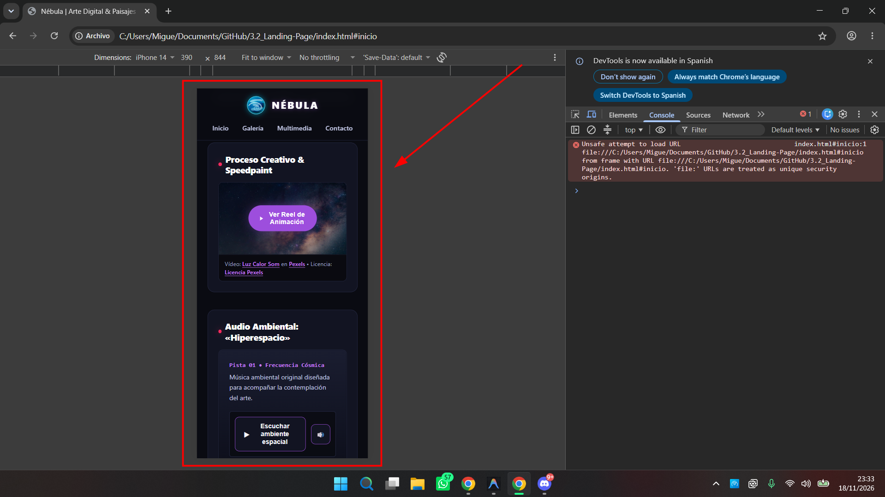
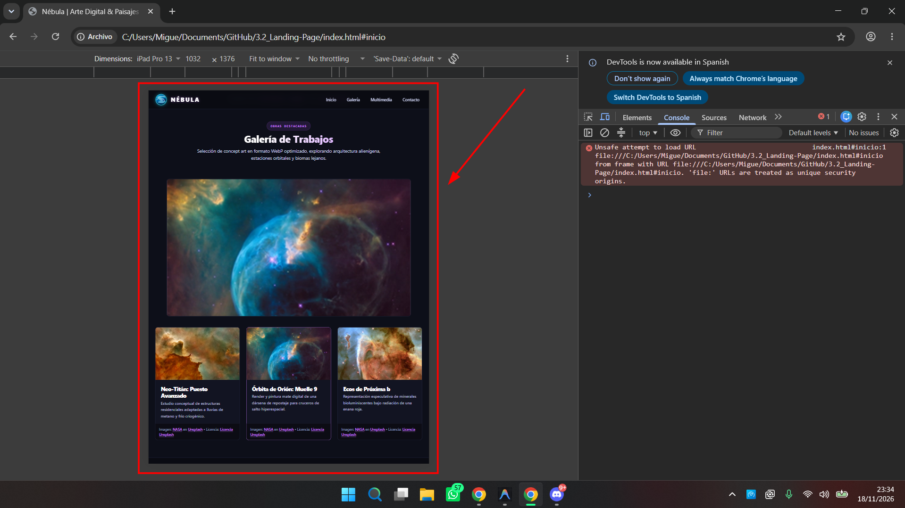
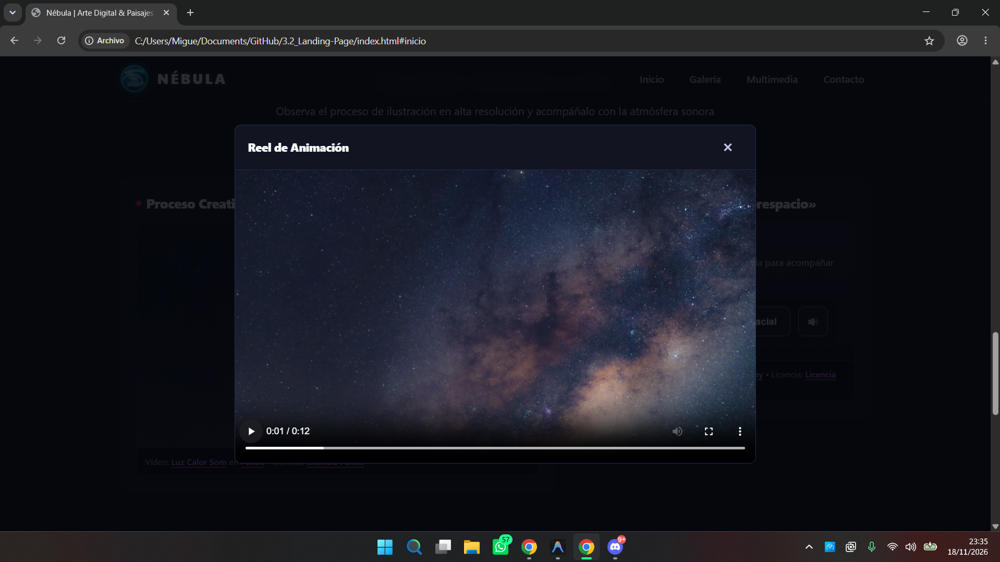
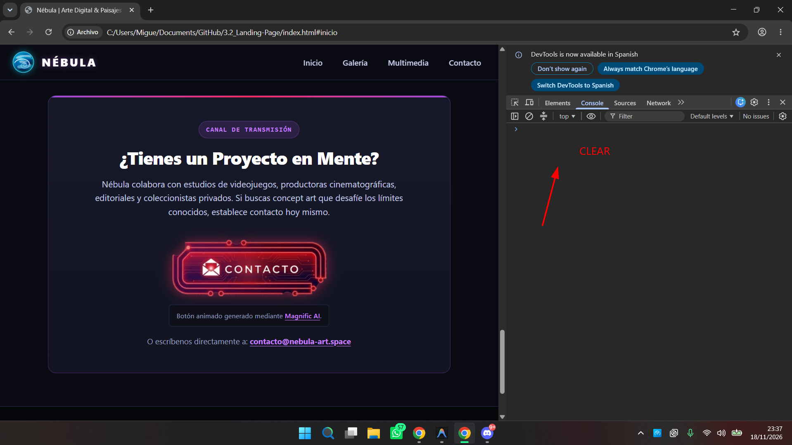

# Landing Page de Artista Digital — «Nébula»

## Introducción

Diseño y maquetación de una *landing page* para la artista digital ficticia **Nébula**, especializada en paisajes de ciencia ficción. En esta actividad se preparan, manipulan y optimizan recursos multimedia (imágenes estáticas, logotipo vectorial, vídeo, audio y animación CTA) aplicando estándares de HTML5 semántico, accesibilidad y rendimiento web (WPO).

---

## Índice
1. [Tabla de Recursos y Licencias](#1-tabla-de-recursos-y-licencias)
2. [Justificación Técnica de Formatos](#2-justificación-técnica-de-formatos)
3. [Herramientas Utilizadas](#3-herramientas-utilizadas)
4. [Propiedad Intelectual y Licencias](#4-propiedad-intelectual-y-licencias)
5. [Verificación Cross-Browser y Multi-Dispositivo](#5-verificación-cross-browser-y-multi-dispositivo)

---

## 1. Tabla de Recursos y Licencias

Listado de cada archivo utilizado en el proyecto, enlace a su URL original de descarga y tipo de licencia otorgada:

| Recurso | Archivo Local | Autor / Creador | Plataforma de Origen | URL Original de Descarga | Tipo de Licencia Otorgada |
| :--- | :--- | :--- | :--- | :--- | :--- |
| **Hero Image** | `assets/img/raster/hero.webp` | [Mark Basarab](https://unsplash.com/es/@markbasarabvisuals) | Unsplash | [Ver en Unsplash](https://unsplash.com/es/@markbasarabvisuals) | Dominio Público / Licencia Unsplash |
| **Miniatura 1** | `assets/img/raster/thumb1.webp` | [NASA](https://unsplash.com/es/@nasa) | Unsplash | [Ver en Unsplash](https://unsplash.com/es/@nasa) | Dominio Público (NASA) |
| **Miniatura 2** | `assets/img/raster/thumb2.webp` | [NASA](https://unsplash.com/es/@nasa) | Unsplash | [Ver en Unsplash](https://unsplash.com/es/@nasa) | Dominio Público (NASA) |
| **Miniatura 3** | `assets/img/raster/thumb3.webp` | [NASA](https://unsplash.com/es/@nasa) | Unsplash | [Ver en Unsplash](https://unsplash.com/es/@nasa) | Dominio Público (NASA) |
| **Logotipo** | Integrado como SVG inline (`index.html`) | Creación propia (original) | Proyecto Nébula | Código vectorial nativo | Licencia del proyecto (CC BY-NC-SA 4.0) |
| **Vídeo** | `assets/video/video.mp4` | [Luz Calor Som](https://www.pexels.com/es-es/@luz-calor-som-99374650/) | Pexels | [Ver en Pexels](https://www.pexels.com/es-es/@luz-calor-som-99374650/) | Dominio Público / Licencia Pexels |
| **Póster Vídeo** | `assets/img/poster.webp` | [Luz Calor Som](https://www.pexels.com/es-es/@luz-calor-som-99374650/) | Pexels | Fotograma extraído del vídeo | Dominio Público / Licencia Pexels |
| **Audio** | `assets/audio/audio.mp3` | [freesound_community](https://pixabay.com/es/users/freesound_community-46691455/) | Pixabay | [Ver en Pixabay](https://pixabay.com/es/users/freesound_community-46691455/) | Dominio Público / Licencia Pixabay |
| **Botón CTA** | `assets/img/cta-animation.webp` | Magnific AI | Magnific | [Ver en Magnific App](https://www.magnific.com/es/app) | Licencia de Uso (Magnific AI) |

---

## 2. Justificación Técnica de Formatos

Breve explicación técnica de por qué se eligió cada formato para optimizar el rendimiento y la experiencia web:

| Formato Elegido | Alternativas Descartadas | Justificación Técnica |
| :--- | :--- | :--- |
| **`.webp`** *(Hero y Miniaturas)* | `.jpg`, `.png` | WebP implementa compresión predictiva VP8, logrando entre un **25% y un 35% más de compresión** que JPEG a idéntica calidad visual. Esto acelera el tiempo de carga (LCP) y reduce drásticamente el consumo de datos móviles sin pérdida perceptible. |
| **`.svg` inline** *(Logotipo)* | `.png`, `.jpg`, `.svg` externo | Al insertarse directamente en el DOM, **ahorra una petición HTTP** y permite manipular sus propiedades vectoriales (`fill`, `stroke`) y estados interactivos (`:hover`, `:focus-visible`) con CSS. Además, escala infinitamente sin pérdida de nitidez en cualquier resolución. |
| **`.webp animado`** *(Botón CTA)* | `.gif` | El formato GIF tradicional está limitado a una paleta fija de 256 colores y transparencia binaria (genera halos y bordes dentados). WebP animado ofrece **color real de 24 bits y canal alfa de 8 bits**, reduciendo el tamaño en más de un 50% con movimientos fluidos. |
| **`.mp4` (H.264 / AAC)** *(Vídeo)* | `.avi`, `.mov`, `.webm` | Estándar universal con **soporte nativo al 100% en todos los navegadores** de escritorio y móviles sin plugins. Su códec H.264 brinda una relación compresión-calidad inmejorable para streaming sin cortes bajo el límite fijado de 3 MB. |
| **`.mp3`** *(Audio)* | `.wav`, `.ogg` | El formato WAV (PCM lineal sin comprimir) superaría los 5 MB para solo 15 segundos. MP3 aplica compresión psicoacústica a 192 kbps, recortando el tamaño a unos **350 KB** preservando una fidelidad excelente para ambientación sonora. |

---

## 3. Herramientas Utilizadas

Software y servicios web empleados en cada proceso de tratamiento y optimización digital:

- **Adobe Photoshop** *(Tratamiento de imágenes y logotipo)*:
  - **Hero Image**: Redimensionada al ancho exacto de **1920 px** (1920×1080 px, 16:9) y exportada en formato WebP optimizado con un peso final de **127,95 KB** (cumple holgadamente el límite de `< 250 KB`).
  - **Miniaturas de Galería**: Recorte y reescalado de las 3 imágenes espaciales de la NASA a tamaño uniforme de **400×250 px**, exportadas a WebP con pesos ligeros de 40 KB, 33 KB y 51 KB.
  - **Logotipo**: Diseñado y creado desde cero como gráfico vectorial mediante **SVG inline** en el DOM (`index.html`) con `viewBox="0 0 48 48"`, empleando primitivas geométricas puras (`ellipse`, `circle`, `polygon`) para posibilitar el control dinámico de propiedades visuales (`fill`, `stroke`) e interactividad (`:hover`, `:focus-visible`) desde CSS.
- **Adobe Photoshop y Ezgif** *(Animación fotograma a fotograma)*:
  - Creación y edición de los fotogramas secuenciales en Photoshop y ensamblado/optimización del bucle en bucle infinito mediante Ezgif, exportado en **WebP animado** transparente a 300×111 px con un peso ultraoptimizado de **22,97 KB**.
- **HandBrake** *(Transcodificación de vídeo y extracción de póster)*:
  - Compresión y ajuste del vídeo a 12 segundos con códec H.264 y audio AAC a un bitrate de ~1.2 Mbps, obteniendo un peso final de **1,83 MB** (cumple el límite de `< 3 MB`).
  - Generación de la imagen fija de precarga obligatoria `poster.webp` (198 KB).
- **Audacity** *(Edición y masterización de audio)*:
  - Recorte del clip de ciencia ficción a una duración exacta de **15 segundos**.
  - Aplicación de curvas suaves de **Fade-in (1,5 s)** al inicio y **Fade-out (2,0 s)** al final para una escucha envolvente sin cortes bruscos.
  - Exportación en MP3 estéreo a **192 kbps** con un peso de **352,71 KB**.

---

## 4. Propiedad Intelectual y Licencias

### Licencia del Proyecto
El proyecto web y su código se distribuyen bajo la licencia **Creative Commons Atribución-NoComercial-CompartirIgual 4.0 Internacional (CC BY-NC-SA 4.0)**, permitiendo su distribución y modificación con fines no comerciales, citando la autoría original y compartiendo las obras derivadas bajo los mismos términos.

### Justificación de Compatibilidad de Licencias
Los recursos utilizados provienen de plataformas con licencias permisivas y gratuitas (Unsplash, Pexels, Pixabay y NASA). Todas ellas autorizan la reproducción y modificación de sus obras sin obligar a licencias privativas ni incompatibles. Al publicar el proyecto bajo **CC BY-NC-SA 4.0**, se cumple con el principio de uso no comercial y se atribuye la autoría correspondiente en la web y en `credits.html`.

### Escenario Hipotético: Recurso con Licencia CC BY-SA
Si uno de los recursos multimedia utilizados estuviese bajo licencia **CC BY-SA (Atribución-CompartirIgual)**:
* La cláusula **SA (*ShareAlike*)** tiene efecto *copyleft* o "viral".
* Cualquier obra derivada que modifique o integre dicho elemento **estaría obligada legalmente a licenciarse exactamente bajo CC BY-SA**.
* Esto impediría usar licencias más restrictivas (como la cláusula NoComercial "NC" o copyright privativo), forzando a que todo el proyecto se publique de forma libre y compatible con CC BY-SA.

---

## 5. Verificación Cross-Browser y Multi-Dispositivo

### Pruebas en Navegadores (Cross-Browser)
Se ha verificado la compatibilidad y funcionalidad en los tres motores de renderizado principales:

| Navegador | Motor | SVG Inline & CSS | Galería JS | Modal de Vídeo | Reproductor Audio | Consola |
| :--- | :--- | :---: | :---: | :---: | :---: | :---: |
| **Google Chrome** | Blink | Correcto | Correcto | Correcto (`.play()/.pause()`) | Correcto (`.play()/.pause()/.muted`) | 0 errores |
| **Mozilla Firefox** | Gecko | Correcto | Correcto | Correcto (`.play()/.pause()`) | Correcto (`.play()/.pause()/.muted`) | 0 errores |
| **Microsoft Edge** | Blink | Correcto | Correcto | Correcto (`.play()/.pause()`) | Correcto (`.play()/.pause()/.muted`) | 0 errores |

### Pruebas Multi-Dispositivo y Accesibilidad Táctil (DevTools)
Mediante las herramientas de desarrollo (*Device Mode* / F12 en Chrome y Firefox) se validaron resoluciones móviles (375×667 px, 390×844 px, 412×915 px) y tablets (768×1024 px):
- **Controles táctiles:** Todos los elementos interactivos (miniaturas de galería, botón «Ver Reel de Animación», cierre de modal, botón de audio y silenciador) superan el tamaño mínimo de **44×44 px** exigido por WCAG para garantizar su pulsación táctil sin dificultad.
- **Responsividad:** El diseño se adapta de forma fluida sin desbordamiento horizontal (*scroll horizontal* nulo) y mantiene la legibilidad tipográfica mediante funciones `clamp()`.

### Evidencias de Comprobación Gráfica

A continuación se documentan las capturas de pantalla obtenidas durante la fase de verificación técnica con DevTools y validación multi-dispositivo:

#### 1. Modo Dispositivo Móvil y Verificación de Controles Táctiles (≥ 44×44 px)
Simulación en resolución móvil con inspección de elementos interactivos, validando que los botones táctiles cumplen con la recomendación de accesibilidad WCAG:

#### 2. Comportamiento Responsive en Tablet y Galería Dinámica
Validación de la adaptación de maquetación en resolución tablet y funcionamiento interactivo de la galería con actualización fluida de la imagen principal:

#### 3. Modal de Vídeo Programático en Ejecución
Apertura de la ventana modal centrada mediante `open-video-btn`, reproducción automática con `.play()` y capa de superposición (*overlay*):

#### 4. Validación Cross-Browser y Consola Limpia
Prueba de ejecución en navegador alternativo (Firefox / Edge) verificando la ausencia total de errores en la consola de JavaScript:

---

> **Nota:** La elaboración y refinamiento de la hoja de estilos (`css/style.css`) ha sido apoyada con Inteligencia Artificial para potenciar la coherencia visual y otorgarle un aspecto más inmersivo, futurista y espacial al proyecto.
